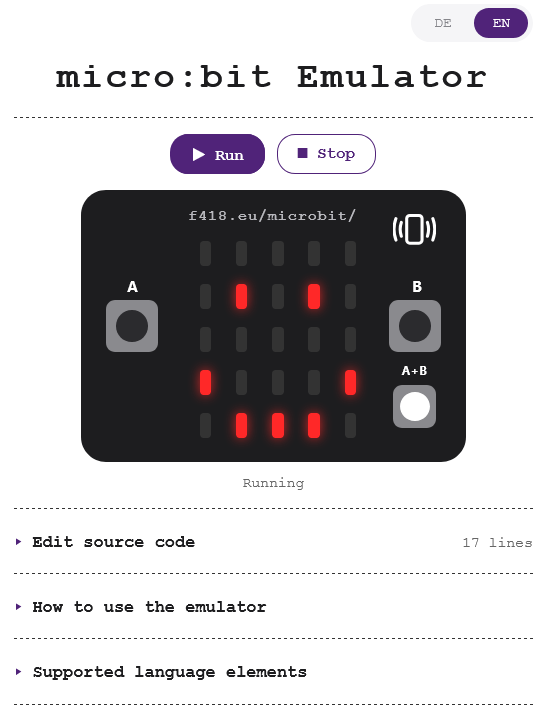

# fgreil's micro:bit Experiments

MakeCode code for the **BBC micro:bit V2** plus a block-diagram tool and a browser emulator. Code comments are in simple German.

**Try code without a micro:bit board**: You can try the emulator at [f418.eu/microbit](https://f418.eu/microbit/), just paste a `.ts` file and press **Start**.

| File | Content |
|---|---|
| `egoshooter.ts` / `egoshooter.md` | notDoom shooter game and its documentation |
| `Kurzanleitung.md` | How to play notDoom, in German, for children |
| `dice.ts` / `dice.md` | Dice program (coin, 6-sided die, numbers 0–9) and its documentation |
| `ts2blocks.py` / `ts2blocks.md` | Draws a MakeCode `.ts` file as an SVG block diagram, and its documentation |
| `emulator/` | One-page micro:bit emulator for the browser, and its documentation |

## Usage for the `.ts` files.

1. **Load**: on makecode.microbit.org, create a new project, import the `.ts` file, and switch to Blocks.
2. **Run**: test it in the simulator, then download it to a micro:bit V2.
3. **Draw**: `python3 ts2blocks.py egoshooter.ts` writes `egoshooter.svg`.
